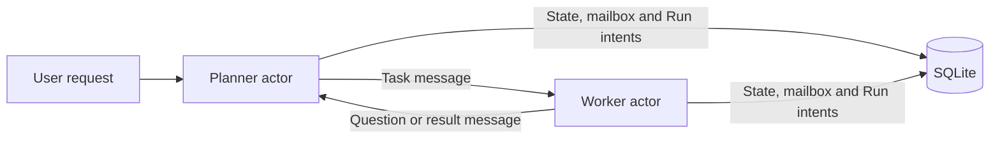

# Durable actors

Actor identity, mailboxes, lifecycle, memory, timers and native integrations.

- [The actor model and act0r](#actor-model)
- [Durable agent actors](#actors)
- [Durable actor memory](#actor-memory)
- [Durable actor reminders](#actor-reminders)
- [Durable actor supervision](#actor-supervision)
- [Bounded local worker concurrency](#worker-concurrency)
- [Registered agent integrations](#agent-integrations)

<a id="actor-model"></a>

## The actor model and act0r

The [actor model](https://en.wikipedia.org/wiki/Actor_model) describes concurrent systems as actors that communicate through asynchronous messages. Each actor controls its own state. Handling a message can produce messages, new actors or a different response to subsequent messages. See also [Carl Hewitt's account of the model](https://arxiv.org/abs/1008.1459).

An AI agent fits this pattern when it has a stable identity, its own task state and message-based interactions with other agents. A planner can delegate a task to a coding worker; the worker can ask a question, run tools and return a correlated result. The scheduler can advance independent actors while a task waits for external work.

In act0r, the application creates actors with registered, versioned behaviors. `AgentDefinition::transition` makes a pure decision from saved configuration, state and one message. It returns replacement state and commands to send a message, validate a Run or start a Run. Actor creation and behavior registration are application operations; model responses use their pinned capabilities.

The actor model itself does not require durable storage or FIFO delivery. act0r chooses persistent mailboxes with per-actor consumption order and atomic state transitions. Native agents retain one active task execution and queue additional accepted tasks within their configured capacity. One actor can handle many tasks over its lifetime; every execution has a separate Run.



The Run engine records model/tool activities, results, deadlines and waits. Actor mailbox transitions commit their state, processed-message receipt, outgoing messages and Run intents together. After restart, the worker reloads these records and advances eligible work. Completed activities reuse their saved results; uncertain external operations retain their repeat-safety and reconciliation rules.

This implementation runs locally with one worker owner per database and configurable activity concurrency. Distribution, remote actor addresses and automatic actor migration are future work. The [architecture guide](architecture.md) explains the current persistence and ownership boundaries.

<a id="actors"></a>

## Durable agent actors

Native registered actors can retain [bounded durable memory across tasks](#actor-memory). The actor owns successful goals/results; each Run owns its immutable selected context. `actor memory status/clear` inspects or clears future context without changing active Runs.

Actors also own [durable one-shot reminders](#actor-reminders). `actor reminder schedule/status/list/cancel` saves future task envelopes and UTC deadlines independently of active Runs. Due reminders wait for a ready mailbox and available task capacity before publication; they survive worker downtime and use memory selected at Run launch.

The native planner can opt in to [self-scheduled follow-ups](planner.md#planner-follow-ups). A model decision finishes the current task and requests one future goal; saved provenance keeps the configured chain limit across subsequent Runs. Task and reminder inspection link the successor back to its source.

A planner's optional [goal budget](state.md#goal-budgets) shares model-call and token allowances across its original task, follow-ups, and delegated descendants. Persisted reservations and exhaustion survive restarts. Separately submitted goals retain independent allowances.

`actor task inspect TASK_ID` provides [goal-level inspection](state.md#task-inspection) from any task or follow-up handle. It follows saved ownership to the original request, shows each actor's execution and wait/stop reason, and reports shared scopes once. The bounded read-only projection includes unpublished intents and marks omitted nodes in readable and JSON output.

`actor task cancel-goal TASK_ID` saves [durable cancellation for that ownership tree](recovery.md#goal-cancellation), including scheduled follow-ups and unpublished children. Admission stops as soon as the receipt commits; cleanup and terminal replies continue through the worker. Completed results and unsafe-operation reconciliation remain available.

`actor task pause-goal TASK_ID` and `resume-goal TASK_ID` control [durable admission holds for the entire goal](recovery.md#goal-pause). Individual actor and Run controls remain separate. In-flight outcomes and terminal replies can settle while further execution waits, and resume retains original deadlines and spending.

An agent actor has a long-lived identity, state, pinned behavior, and durable mailbox. Its `AgentId` survives multiple task executions; each task uses a separate `RunId`. State changes happen one message at a time. Model calls, tools, retries, timers, approvals, and recovery execute through the existing Run engine.

Actors also support opt-in [durable supervision](#actor-supervision). Repeated terminal Run failures can pause a worker before the next task launches. Failure receipts and retained work survive restart; `actor supervision status/recover` provides inspection and explicit recovery. An ordinary resume cannot bypass a supervision pause.

Native [tool-enabled actors](tools.md#native-tools) share the answering policy with an explicit versioned tool allowlist. Calls and approvals use existing durable Run activities and waits. Discover local contracts with `actor tool list` and create an actor with `actor agent create tool`.

<a id="actors--restart-demo"></a>

### Restart demo

No model server or API key is required:

```powershell
cargo run --locked --example actors -- .build/actors-demo/demo.db
```

The demo creates a coordinator and workflow worker, sends a task, commits the outgoing message and the worker's run, closes the app, and opens the same database again. The resumed worker completes the task and delivers a correlated reply. Output includes both stable agent IDs, the request ID, the saved reply, and the separate run ID. The example closes cleanly; tests also kill worker processes at six persistence boundaries.

<a id="actors--cli"></a>

### CLI

The existing `worker run` drives mailbox turns and workflow execution:

```powershell
cargo build --locked
$db = '.\actors.db'
$workerId = (& .\target\debug\act0r.exe --db $db actor create workflow_worker --config-file .\examples\configs\actor-worker.json).Trim()
@{ worker = $workerId } | ConvertTo-Json | Set-Content .\coordinator.json
$coordinatorId = (& .\target\debug\act0r.exe --db $db actor create coordinator --config-file .\coordinator.json).Trim()
$messageId = [guid]::NewGuid().ToString()
.\target\debug\act0r.exe --db $db actor send $coordinatorId --input-file .\examples\configs\actor-task.json --message-id $messageId
.\target\debug\act0r.exe --db $db worker run --until-idle
.\target\debug\act0r.exe --db $db actor status $coordinatorId
.\target\debug\act0r.exe --db $db actor status $workerId
.\target\debug\act0r.exe --db $db actor inbox $coordinatorId
```

`actor create` also accepts `--agent-id` and `--definition-version`. Repeating creation with the same ID, definition, and configuration returns the existing agent without resetting it; a different configuration conflicts. `actor send` accepts `--kind` (default `task`), `--sender`, and `--correlation-id`. The returned message ID identifies durable acceptance. Repeating the same envelope with the same ID is harmless before or after processing; changing its sender, recipient, correlation, kind, or payload conflicts. Use a new ID for new work.

Status includes current state, linked runs, and task queue usage. Inbox includes queued, processed, and rejected envelopes, sequences, errors, timestamps, and processing revisions. `--json` supports machine-readable create/send output; status and inbox always render JSON. Sender IDs must refer to existing agents. These local APIs assume trusted callers and do not authenticate claimed sender identities.

`actor pause/resume AGENT_ID` controls mailbox consumption. A paused mailbox still accepts messages. It does not pause an already launched Run; use `run pause/resume/cancel RUN_ID` for that execution. Human waits, paused runs, and reconciliation blocks remain under the Run lifecycle. `--until-idle` exits when only waiting, paused, or blocked work remains, unless a ready actor with task capacity has a scheduled reminder. In that case it stays alive through the saved deadline.

<a id="actors--task-handles-and-cancellation"></a>

### Task handles and cancellation

Every accepted `task` envelope creates an `AgentTask` whose ID is the message ID returned by `actor send`. It is distinct from a multi-candidate `CodingTask`. A coordinator's outgoing request records its parent handle; inspection follows that saved delegation to the worker's execution. Correlation IDs can repeat across different agents without merging handles.

```powershell
.\target\debug\act0r.exe --db $db actor task status $messageId
.\target\debug\act0r.exe --db $db actor task list $coordinatorId
.\target\debug\act0r.exe --db $db actor task cancel $messageId
```

These commands return JSON. Read the top-level `status`, `run_id`, `execution_agent_id`, `reply`, `wait`, `admitted_attempts`, and `usage`. The nested `task` records the original recipient, parent, correlation, cancellation intent, timestamps, and saved outcome. Execution status comes from the authoritative stored Run, so waits, pauses, and charges survive restart without a second independent execution state machine.

Tasks with configured or inherited shared allowances also expose `shared_budgets`, containing combined usage, persisted exhaustion, and individual member ledgers. See [shared delegation budgets](coordination.md#delegation-budgets) for the field contract.

Statuses are `queued`, `running`, `waiting`, `paused`, `blocked`, `cancelling`, `succeeded`, `failed`, `rejected`, `budget_exhausted`, and `cancelled`. `running` means a run has been created, including intervals between activities. A terminal execution outcome is inspectable as soon as the Run saves it; its mailbox notification and actor reply can still be awaiting processing. Cancellation after that save returns the existing outcome.

Cancelling a queued handle removes its delegated requests from mailboxes and the worker's accepted pending queue in one transaction, with a saved cancellation reply. Unconsumed envelopes get rejected receipts explaining cancellation; they never invoke the agent handler. No run or model/attempt allowance is created for accepted pending work that is removed. A repeated cancellation or redelivery does not restart work or duplicate replies.

For an active run, cancellation uses `Run::cancel`: a human wait or idle activity boundary cancels immediately; an in-flight activity reports `cancelling` until its outcome or recovery is saved. A native delegation wait remains `cancelling` until its child is terminal. Already admitted work retains its charges and uncertain-effect evidence. Cancellation does not interrupt a host process or undo external effects. A blocked uncertain Run still requires its existing reconciliation procedure before lifecycle controls can proceed. Mailbox pause and task cancellation are separate controls; cancellation works while a mailbox is paused.

Custom behaviors support removing accepted queued tasks by implementing the pure `AgentDefinition::cancel_requests` hook. The default reports unsupported cancellation and rolls back the transaction. Unconsumed requests and active Run controls do not need this hook. Coordinator forwarding permits one delegated child or one run per request, with the same correlation along that task parent chain. Native planner delegation links a parent Run to independent child tasks; parent inspection exposes the pending `delegation.id` and its own usage. See [native delegation](coordination.md#delegation) and [task groups](coordination.md#task-groups) for child inspection, ordered joins, inherited limits, cancellation propagation, and recovery. The same planner can [call native tools](planner.md#planner-tools) before or after delegation.

Run the A/B/C demonstration without a model server:

```powershell
cargo run --locked --example actor_tasks -- .build/actor-tasks-demo/demo.db
```

It records three delegated tasks, cancels B after it enters the worker's pending queue, reopens the database, and verifies that A and C succeed while B has no run, attempts, or model usage.

<a id="actors--bounded-task-admission"></a>

### Bounded task admission

Every actor pins an `AgentQueuePolicy` separately from its behavior configuration. Its default `task_capacity` is 65: enough for the previous worker's one active and 64 pending tasks. Both creation commands accept a positive `--task-capacity`:

```powershell
$workerId = (& .\target\debug\act0r.exe --db $db actor create workflow_worker --config-file .\examples\configs\actor-worker.json --task-capacity 2).Trim()
.\target\debug\act0r.exe --db $db actor status $workerId
```

The limit counts unfinished task handles assigned to that actor: queued mailbox requests, consumed requests waiting in behavior state or awaiting delegation, and requests with an active execution. A coordinator and its worker each account for their own assigned request. Waiting, paused, blocked, and cooperatively cancelling executions retain their slot. A saved terminal Run releases capacity immediately, even before its completion notification is delivered. Queued cancellation releases capacity in the same transaction as queue removal and the saved reply.

New public tasks that exceed capacity return the typed Rust `Error::QueueFull` and a nonzero CLI exit with `QueueFull` in stderr. They save no mailbox entry, task handle, Run, or usage charge. Retry with the same envelope and message ID after capacity becomes available. Identical redelivery of an already accepted envelope succeeds even when the queue is full; changed envelopes still conflict.

Actor-produced tasks obey the recipient's limit too. If a delegation or outgoing batch would exceed it, the originating turn saves a rejected receipt without applying its proposed business state, sending any of the batch, or creating a Run. For a tracked task, inspection shows `rejected` with `reply.admission.code = "queue_full"`, the full recipient's ID, capacity, outstanding count, and requested slots. The original sender receives the saved runtime rejection. Redelivery preserves this terminal rejection; a caller must submit a new task ID to try the operation again. The harness does not retry rejected delegations automatically.

Replies, runtime completion and rejection notifications, and other non-task messages bypass the task limit so accepted work can finish while the task queue is full. This policy bounds outstanding tasks; mailbox history, arbitrary non-task traffic, and artifact retention have separate storage concerns.

`actor status` returns a `queue` snapshot with `capacity`, `outstanding`, `available`, `mailbox_tasks`, `pending_tasks`, and `executing_tasks`. The last three counts sum to `outstanding`; `executing_tasks` follows delegation to the saved Run and includes its input waits and lifecycle controls. The Rust API exposes `ActorService::queue`, `create_with_queue_policy`, and `AgentService::create_coding_actor_with_queue_policy`. Existing creation APIs use the default policy. Recreating an actor with a different policy conflicts, just like changing its pinned behavior configuration.

The baseline indexes open task handles. An omitted queue policy uses capacity 65. Actors with more outstanding work can continue processing and cancelling it; new tasks are refused until the queue falls below capacity. Inspection never drops accepted work or resets actor state.

Try the bounded A/B/C demo without a model server:

```powershell
cargo run --locked --example actor_queue -- .build/actor-queue-demo/demo.db
```

It fills two slots, observes `QueueFull` for C, cancels B from the accepted pending queue, retries C using its original unaccepted message ID, and restarts. A and C finish, B creates no Run, and both slots become available again.

<a id="actors--coding-workers"></a>

### Coding workers

Create a worker backed by the native coding agent:

```powershell
$codingId = (& .\target\debug\act0r.exe --db $db actor coding-worker --source .\examples\benchmark-cases\addition\source --config-file .\examples\configs\agent-scripted.json --attempt-limit 30).Trim()
@{ goal = 'Fix add to return the sum and run the fixed tests.' } | ConvertTo-Json | Set-Content .\coding-task.json
.\target\debug\act0r.exe --db $db actor send $codingId --input-file .\coding-task.json
.\target\debug\act0r.exe --db $db worker run --until-idle
.\target\debug\act0r.exe --db $db actor status $codingId
```


Each coding actor has its own persistent managed workspace. Model/tool settings, permissions, the test command, context policy, and per-run budgets are pinned on creation. A task's `goal` replaces the configured goal without overriding those settings. Project changes carry between tasks. A new actor gets a fresh workspace copy. The coding-worker convenience command allocates a new agent ID on each invocation.

New coding workers use the registered `coding` v1 adapter and `agent_worker` v1 behavior. `actor agent list` discovers versioned capability manifests, while `actor agent create coding/answer/planner/tool` creates native behaviors through the same contract. Model-only answering needs no workspace. Tool and planner actors can opt in to a persistent managed source copy with [workspace tools](tools.md#workspace-tools). Registrations are pinned in actor configuration and task Run input/state; missing or changed implementations block before execution. Restore the exact integration and resume the affected actor and Run to continue. Older workflow workers preserve their original configuration. See [agent integrations](#agent-integrations) for creation, capabilities, checked recovery, and the coding/answer restart demo.

A workflow worker permits one task run at a time and retains further accepted tasks in its state within the actor's pinned capacity. It receives new messages while work is active, validating their workflow input before recording tasks for later execution. Invalid queued work receives a rejection reply without disrupting the active task or later valid tasks. A terminal result launches the next queued task. Validation does not persist a run, execute tools, or consume model/attempt allowances. Each run has its own attempt/model/token allowances; this slice has no lifetime budget across all tasks of an agent. Task and Search budgets retain their existing contracts.

Generic workflow workers use `{ "workflow": { "name": "demo", "version": 1 }, "input": { "message": "Actor task" }, "attempt_limit": 10 }`. Input is pinned; a goal is substituted only when the input has a goal field. Replies expose the run status, result, error, and run ID. Failed, cancelled, and budget-exhausted runs produce failure replies; blocked and waiting runs remain pending. Rejected delegated messages produce a saved runtime rejection reply so the coordinator can finish that request with failure evidence.

<a id="actors--rust-api-and-ddd"></a>

### Rust API and DDD

`local_app` returns the engine and agent services. `agents.actors()` exposes `ActorService::create/send/status/mailbox/runs/pause/resume`, `task/tasks/cancel_task`, and queue inspection and policy-aware creation. `agents.registrations()` discovers agent integrations; `agents.create_registered_actor` prepares configuration and creates coding, answering, or planner actors. `agents.create_coding_actor` is its coding convenience API. The [Rust example](../examples/actors.rs), [task lifecycle example](../examples/actor_tasks.rs), [bounded queue example](../examples/actor_queue.rs), [integration example](../examples/agent_integrations.rs), and [native delegation example](../examples/actor_delegation.rs) use these public services.

| Boundary | Responsibility |
| --- | --- |
| `domain::actors::Agent` | Stable identity, pinned configuration, state, revision, mailbox progress, and lifecycle rules. |
| `AgentTask` | Original request identity, delegation, cancellation intent, run linkage, and immutable terminal reply. |
| `AgentQueuePolicy` and `AgentQueue` | Pinned task capacity and inspection of unfinished assigned requests. |
| `AgentDefinition` | Pure versioned initialization and message transitions. Returns new state plus `Send`, `ValidateRun`, or `StartRun` commands. |
| `ActorService` | Resolve definitions and translate commands into outgoing envelopes and run intents. |
| `ActorStore` | Atomic admission, mailbox processing, state changes, run linkage, and completion notifications. |
| SQLite adapter | Persist agents, mailboxes, and run links using the existing database and IMMEDIATE transactions. |
| `Run` and existing adapters | External execution, budgets, controls, timers, approval waits, and uncertain-operation recovery. |

Custom behavior implements `AgentDefinition` and is registered in `ActorService::new`; wire the service into `Engine::with_coordinator` as a `WorkCoordinator`. Handlers process serializable messages synchronously and express I/O through commands. A turn may emit up to 16 commands and start at most one run. Storage enforces at most one unnotified execution per actor and one execution per request. The built-in `coordinator`, `workflow_worker`, and `agent_worker` definitions are version 1. Missing pinned agent/workflow definitions block without consuming the message. Once the implementation is available, resume the agent to process its retained envelope. Registered agent adapters add capability pins and workflow wrappers while reusing these mailbox and Run rules.

<a id="actors--delivery-and-recovery"></a>

### Delivery and recovery

Mailbox sequence numbers establish FIFO consumption for each ready agent. The local worker also chooses the earliest ready envelope globally. Revisions serialize through the Agent consistency boundary. Completed mailbox turns are not re-executed.

State, consumed-message receipt, outgoing local messages, new run/activities, and run linkage commit together. Local routing inserts directly into the recipient's mailbox within the same transaction. External I/O starts after the run intent commits. Completion and notification are separate resumable transactions: a stable completion-message ID is reserved with the run link, and inserting that envelope commits with marking the link notified. Consuming the result and saving a correlated reply is another atomic turn.

Envelopes have an ID, optional sender, recipient, kind, payload, and optional correlation ID. An omitted correlation defaults to the original message ID. `$run_completed` and `$message_rejected` are reserved runtime events; public sends and agent-produced sends cannot forge them. Public payloads are limited to 65,536 serialized JSON bytes. Rejection preserves prior business state and saves a receipt; a sender receives a correlated rejection notification. Database or commit failures roll back the entire turn for retry.

There is one committed state transition per message ID in the local database. External model/tool execution retains existing repeat-safety and reconciliation rules: an operation can execute before a crash prevents saving its result. Mailbox deduplication does not establish exactly-once external effects.

The baseline stores actor mailboxes, task handles, queue admission indexes and delegation ownership links. Task and Run payloads persist across restart. One OS ownership lock still permits one worker per database. The worker now supports [bounded concurrent activities](#worker-concurrency) across actors, preserving one task execution per actor and one activity per Run. Mailbox turns, timers and cancellation propagation progress while external I/O is pending. Distributed delivery, sender authentication, retention, and lifetime agent budgets remain later extensions. Planning strategies can use these boundaries independently; MCTS is deferred while the core agent contract develops.

The baseline includes optional native delegation deadlines. Existing open waits keep their original behavior; configured deadlines survive pause and worker downtime, and expiry cooperatively cancels child work while preserving its results and charges. See [durable delegation deadlines](coordination.md#delegation--durable-delegation-deadlines) for configuration, completion ordering, reconciliation, and inspection.

The baseline includes optional shared model/token allowances for native delegation. Membership follows ownership links when child Runs are created; admission checks and retained usage commit with Run changes. A new root task gets its own allowance, and nested planners can add tighter subtree limits. See [shared delegation budgets](coordination.md#delegation-budgets) for configuration and combined/per-agent inspection.

<a id="actors--verification"></a>

### Verification

```powershell
cargo test --test actors --locked
cargo test --test actor_tasks --locked
cargo test --test actor_queue --locked
cargo test --test agent_integrations --locked
cargo test --test delegation --locked
cargo fmt --all --check
cargo clippy --all-targets --locked -- -D warnings
cargo test --all-targets --locked
```

Checks cover concurrent duplicates and conflicts, missing recipients, reserved events, sequential tasks, stable identities, pauses, missing-version blocks, rejection replies, invalid queued work, coding-agent approval waits, CLI inspection, atomic message/run/notification/reply rollback. Task checks cover A/B/C cancellation, parent/child handles, equal correlations across agents, cancellation before consumption and after delegation, approval and pause inspection, active cancellation and retained charges, completion winning over late cancellation, cancellation rollback, duplicate replies. Process-kill checks stop after forwarding, run creation, execution before persistence, saved completion, saved notification, queued reply, committed pending-task cancellation, and committed active cancellation. Recovery preserves identities, replies once, and retains interrupted-attempt charges.

Queue checks cover concurrent saturation, duplicate admission, failed acceptance rollback, consumed pending and delegated work, cancellation with retained in-flight charges, terminal Run capacity release before notification, replies while full, atomic delegated rejection and outgoing batch reservation, configured capacities above 65, actors draining overfull queues, and CLI policy configuration for workflow and coding workers. Process-kill checks preserve both committed admission and committed slot release without inventing handles for refused work.

<a id="actor-memory"></a>

## Durable actor memory

Native coding, answering, and planner actors can retain a bounded history of successful task goals and final results. The Actor owns this history; each Run owns an immutable snapshot selected at launch. Memory is opt-in and uses the existing SQLite actor transaction, without another scheduler or database table.

<a id="actor-memory--configuration-and-commands"></a>

### Configuration and commands

Use `actor memory status AGENT_ID` to inspect retained entries and `actor memory clear AGENT_ID` to clear one actor's memory. The harness memory API also exposes current entries and immutable launch snapshots, with bounded results and explicit truncation. SQLite commits API clears and their receipts atomically; retrying the same request cannot clear later memory again. See [memory routes](api.md#http-api--prompt-first-harness).

Clearing preserves conversation, task results, follow-up conversation context and every existing Run's snapshot. It affects future launches and prevents pre-clear completions from refilling that actor's memory. Start a new session for a fresh conversation.

Add this field to the JSON passed to `actor agent create` or `actor coding-worker`:

```json
"memory": { "max_entries": 8, "max_bytes": 8192 }
```

`"memory": {}` uses these defaults. Omitting the field disables memory. `max_entries` accepts 1–64; `max_bytes` accepts 128–65536 and measures the serialized UTF-8 bytes of the entries array, including JSON escaping. This is a byte limit, not a tokenizer. The runtime selects `actor_memory`; callers cannot supply a snapshot in actor configuration.

```powershell
.\target\debug\act0r.exe --db $db actor memory status $agentId
.\target\debug\act0r.exe --db $db actor memory clear $agentId
```

Both commands return JSON containing the actor ID, memory (or `null` when disabled), and retained bytes. Memory includes its policy, revision, clear generation, omission count, and entries. Each entry records the original task message ID, effective goal, and complete final result. The Rust API exposes `ActorService::memory` and `clear_memory`; creation uses `AgentService::create_registered_actor` with the same JSON configuration.

Run the scripted restart demonstration without a model server or credentials:

```powershell
cargo run --locked --example actor_memory -- .build/actor-memory-demo/demo.db
cargo test --locked --test actor_memory
```

The example completes one task, closes and reopens the application, completes a second task, and verifies that the second model prompt contains the first task's saved goal and result. Its scripted model validates the context plumbing; real models decide how to use that context.

<a id="actor-memory--retention-and-prompt-selection"></a>

### Retention and prompt selection

Only a `succeeded` completion enters memory. Failed, rejected, cancelled, and budget-exhausted tasks add no entry. Successful completion consumption saves the entry, receipt, outgoing reply, and any next queued Run in one transaction. Repeated delivery creates no additional entry or continuation.

Retention removes whole oldest entries until both limits fit. A new entry larger than the entire byte allowance is skipped, preserving older retained entries and recording an omission. Original results remain available in Run history. Memory keeps final results, rather than tool transcripts or model reasoning, and does not summarize or rewrite them.

At launch the native registered workflow chooses a contiguous suffix that fits its first model request. It can omit all entries if necessary; the current goal, instructions, and schema must still fit. The selected snapshot is saved in both Run input and native workflow state, including actor ID, revision, generation, and omissions. Queued tasks select at launch, so they see tasks completed while waiting.

Every later model request uses that same snapshot. Model retries, human waits, restart recovery, and coding context selection do not select newer actor memory. Memory prompt bytes and its instructions count toward input limits and usage reservations, including both schema copies for Chat Completions. A later essential tool result or clarification can still exceed the configured context limit; memory selection does not silently change mid-Run.

Memory is supplied as prior task data, with instructions to verify facts against the current task and environment. It does not grant tools, change permissions, or transfer another actor's memory. Planner child actors keep independent histories; delegation does not inherit the parent's snapshot.

<a id="actor-memory--clearing-and-recovery"></a>

### Clearing and recovery

Clearing removes retained entries, resets the omission count, and increments revision and generation in one transaction against current actor state. It works while the mailbox is paused or blocked and preserves those controls. A task launched before the clear cannot reintroduce its result afterward: its saved generation must match before completion can append memory. Tasks launched after the clear use the new generation.

Clearing affects future context. Existing Run inputs, model requests, task receipts, final results, and other historical records remain intact. It is not a history deletion command.

The current database version guards the extended actor state so older runtimes reject the database instead of silently dropping memory.

Regression tests cover count and UTF-8 bounds, initial prompt selection for all three native workflows and both protocols, isolation, queued task context, duplicate delivery, retries, waits, clearing, transactional rollback, and process kills after Run completion, notification publication, memory append/next Run creation, and next model admission.

The same panel offers [conversation summaries](state.md#session-summaries). A summary belongs to the session and is pinned separately into future Runs. Clearing one actor does not clear the summary.

<a id="actor-reminders"></a>

## Durable actor reminders

An actor can own a one-shot future task independently of any active Run. Registration saves the task envelope and a UTC deadline in SQLite; the existing worker publishes it into the actor's mailbox when due. A stopped worker loses no schedule: overdue work becomes eligible after restart, even if the actor's earlier task has finished.

<a id="actor-reminders--cli-and-rust-api"></a>

### CLI and Rust API

Create an actor as described in [agent integrations](#agent-integrations), then schedule a task using its ID:

```powershell
cargo build --locked
$db = '.\actors.db'
$messageId = [guid]::NewGuid().ToString()
@{ goal = 'Check the result of the earlier task.' } | ConvertTo-Json | Set-Content .\follow-up.json
.\target\debug\act0r.exe --db $db actor reminder schedule $agentId --input-file .\follow-up.json --after-ms 60000 --message-id $messageId
.\target\debug\act0r.exe --db $db actor reminder status $messageId
.\target\debug\act0r.exe --db $db actor reminder list $agentId
.\target\debug\act0r.exe --db $db worker run --until-idle
.\target\debug\act0r.exe --db $db actor task status $messageId
```

Choose exactly one of `--after-ms MILLISECONDS` or `--at-unix-ms UTC_TIMESTAMP`. A delay resolves once when registration is first saved. An absolute deadline is a signed Unix timestamp in milliseconds; a past deadline or zero delay is eligible on the next worker turn. Oversized delays that overflow the timestamp range are rejected. Optional `--sender` and `--correlation-id` preserve ordinary actor reply routing; a sender must exist.

All reminder commands return JSON. Status includes the original envelope and deadline, resolved `due_at`, and registration, publication, and cancellation timestamps. `scheduled` means awaiting publication; `published` means a mailbox entry and task handle exist, and task execution can still be queued, waiting, failed, or complete. `cancelled` means publication was prevented. Listing includes historical published and cancelled records as well as pending work.

The Rust API uses the same contract:

```rust,no_run
use act0r::{application::ActorService, domain::{actors::AgentMessage, TimerDeadline}};

async fn schedule(actors: &ActorService, message: AgentMessage) -> Result<(), act0r::Error> {
    let reminder = actors.schedule_task(
        message, TimerDeadline::After { milliseconds: 60_000 },
    ).await?;
    let _saved = actors.reminder(reminder.id).await?;
    let _history = actors.reminders(reminder.message.recipient).await?;
    let _cancelled = actors.cancel_reminder(reminder.id).await?;
    Ok(())
}
```

The envelope must use `kind: "task"` and pass the public message validation, including the 65536-byte payload limit. Input validation by the actor's behavior happens on the normal mailbox turn. Generic workflow workers, registered native actors, and coordinators can all receive reminder tasks.

Run the scripted restart demo without a model server or credentials:

```powershell
cargo run --locked --example actor_reminders -- .build/actor-reminders-demo/demo.db
cargo test --locked --test actor_reminders
```

It completes a task, schedules a follow-up, closes the application through the deadline, reopens the database, and verifies one completed follow-up using the first task's actor memory. The scripted model checks context plumbing; real models decide how to use that context.

<a id="actor-reminders--identity-cancellation-and-capacity"></a>

### Identity, cancellation, and capacity

The reminder ID is its eventual message ID and task handle. Supply a stable `--message-id` when registration may be retried. Repeating the exact envelope and original deadline returns the saved record, even after publication or cancellation, without moving the deadline or creating another task. Changing either conflicts. Equivalent resolved times with different deadline specifications still conflict. Omitting the ID creates new work on every invocation.

A reminder reserves this ID immediately. An ordinary `actor send` with that ID cannot bypass the deadline or revive a cancelled schedule. After publication, identical sends deduplicate against the mailbox normally. IDs already used by a mailbox message or reserved runtime completion/delegation cannot become reminders.

```powershell
.\target\debug\act0r.exe --db $db actor reminder cancel $messageId
```

Cancellation and publication are serialized by SQLite transactions. If cancellation wins, there is no mailbox entry, task handle, or Run. If publication wins, cancelling the reminder returns its unchanged `published` record; use `actor task cancel MESSAGE_ID` to cancel the accepted task. Repeated cancellation is idempotent. Published and cancelled IDs remain reserved in retained history.

Each actor can have at most 64 pending reminders. This bound is independent of its [task capacity](#actors--bounded-task-admission). Registration creates no Run and consumes no task slot. Publication consumes a slot through the same capacity check as ordinary tasks. A paused, blocked, or full actor keeps overdue work scheduled until it becomes eligible. One full actor does not prevent publication to another ready actor. Direct tasks can take available slots before a reminder publishes; reminders do not reserve capacity in advance.

`actor pause/resume` controls reminder eligibility along with mailbox consumption. Clearing actor memory preserves reminders; the future task selects memory when its Run launches, so it sees successful work completed while it waited. Each reminder task is a new root execution with the actor's pinned configuration and per-Run limits; it does not inherit an earlier task's delegation budget.

The worker checks saved deadlines during its normal polling turns. There is no promise of execution at an exact instant. `worker run --until-idle` stays alive for future reminders whose actors are ready and have task capacity. Paused, blocked, or full actors' schedules alone do not keep it alive; restart the worker when those controls or capacity change. Mailbox publication still progresses while the worker's external activity concurrency is full; actual model/tool admission obeys the configured limit.

<a id="actor-reminders--persistence-boundaries"></a>

### Persistence boundaries

The Actor aggregate owns its bounded pending reminder IDs and revision. `ActorReminder` owns the saved envelope, deadline, and lifecycle. `ActorService` coordinates through the `ActorStore` port; SQLite and the existing worker remain adapters. The baseline includes indexed reminder records and protects the extended Actor payload against older runtimes.

Registration saves the record and Actor ID together. Cancellation saves its receipt and removes that ID together. Publication saves the mailbox entry, task handle, published receipt, and Actor update together. A crash cannot leave a published receipt without its accepted task, or admit the same reminder twice. Run creation and execution then follow the ordinary actor/Run recovery contract, including reconciliation for uncertain external side effects.

Tests cover restart and real process kills before publication, after publication, after Run creation, during model admission, and after cancellation. They also cover exact registration retries, reserved IDs, concurrent cancellation/publication, full queues, actor controls, memory, correlated coordinator delegation, worker concurrency, transaction rollback.

Rust and CLI expose one-shot scheduling. The [native planner](planner.md#planner-follow-ups) also supports opt-in, bounded self-addressed follow-ups through its model decision schema. Periodic schedules and cron/calendar rules remain later work.

<a id="actor-supervision"></a>

## Durable actor supervision

Supervision gives an actor a pinned policy for repeated terminal task failures. At its threshold, the actor finishes the current completion mailbox turn, saves the failure reply, and pauses before launching another Run. Its accepted tasks, memory, reminder deadlines, and execution history survive the pause and worker downtime.

<a id="actor-supervision--configuration"></a>

### Configuration

Native coding, answering, and planner actors accept this optional field in their creation configuration:

```json
"supervision": { "max_consecutive_failures": 3 }
```

Omitting it preserves the existing behavior. The threshold accepts 1–64. The application removes the policy before preparing the model/workflow input and pins it on the Actor aggregate. Task payloads cannot change it. Recreating an actor with the same ID must use the same policy; existing health is preserved.

Generic workflow workers can opt in through the Rust API or CLI:

```powershell
.\target\debug\act0r.exe --db $db actor create workflow_worker --config-file worker.json --max-consecutive-failures 3
```

`ActorService::create_with_policies` accepts the queue policy and an optional `SupervisionPolicy`; existing creation methods remain unsupervised. `AgentDefinition::supports_supervision` and `transition_supervised` make queue suspension an explicit behavior contract. The built-in workflow worker and registered worker implement it. Coordinator and custom behaviors remain unsupervised unless they implement that contract.

<a id="actor-supervision--counting-and-pauses"></a>

### Counting and pauses

Only a successfully processed `$run_completed` notification with status `failed` increments the counter. A successful Run resets it to zero. Cancelled or budget-exhausted Runs leave it unchanged; rejected task envelopes, human waits, blocked integrations, manual pauses, and individual retry failures do not count. Per-activity retries continue through the existing Run engine. A planner that handles a failed child's outcome and finishes successfully records a success of its own.

The counter changes with the completion mailbox receipt, Actor business state, and outgoing failure reply in one transaction. Stable runtime completion IDs and saved mailbox processing prevent duplicate counting across redelivery or restart. Supervision is observed when the mailbox turn runs: a manually paused or blocked actor retains its notification until it can process it.

At the threshold, the Worker releases the finished active task and keeps its pending tasks in order. It emits no next Run. The Actor's status becomes `paused`; `supervision.pause` identifies the failure that caused it. Already finished task results and usage remain final. Other actors continue running.

Paused actors still accept public tasks within their queue capacity. Due reminders retain their original deadlines and remain scheduled until the actor is ready and has available capacity. Queued task cancellation, reminder cancellation, and memory clearing keep their existing behavior. Clearing memory leaves supervision history intact. The worker can become idle while an actor is paused.

<a id="actor-supervision--inspect-and-recover"></a>

### Inspect and recover

```powershell
.\target\debug\act0r.exe --db $db actor supervision status $agentId
.\target\debug\act0r.exe --db $db actor status $agentId
.\target\debug\act0r.exe --db $db actor supervision recover $agentId
.\target\debug\act0r.exe --db $db worker run --until-idle
```

Inspection reports the policy, consecutive failure count, last 16 failure receipts, pause cause, recovery count, and last recovery time. Each failure receipt links its original task and Run, records the observation time, and retains at most 2048 UTF-8 bytes of the error message. The linked Run keeps its complete error and usage. The Rust APIs are `supervision` and `recover_supervision`; inspection reads Actor metadata without requiring the behavior implementation.

An ordinary `actor resume` cannot bypass a supervision pause. Explicit recovery resets the counter, clears the latch, marks the actor ready, and atomically saves a reserved `$supervision_recovered` mailbox wakeup. It preserves failure receipts, terminal tasks, memory, budgets, configuration, and deadlines. Recovery does not retry any failed task. Calling it again while no latch exists has no effect; calling it on an unsupervised actor returns an error.

The wakeup starts retained pending work even when no new public task arrives. Tasks accepted into the mailbox while paused cannot jump ahead of older pending tasks. A manual pause after recovery still stops mailbox processing; an ordinary resume releases that manual pause. Missing registrations continue to block work until the existing compatibility controls are satisfied.

<a id="actor-supervision--persistence-and-recovery"></a>

### Persistence and recovery

Actor owns supervision policy and health. Run owns execution, retries, and failure facts. Behavior transitions suppress the next launch when Actor supervision predicts a pause. Application services coordinate these decisions through ActorStore; SQLite implements the atomic mailbox turn and recovery transaction. The domain performs no database or clock I/O.

The current database version prevents older binaries from dropping health or rejecting a saved recovery wakeup. Actors without a supervision policy remain unsupervised; restart preserves their saved state and execution inputs.

Run the deterministic demo without credentials:

```powershell
cargo run --locked --example actor_supervision -- .build/actor-supervision-demo/demo.db
cargo test --locked --test actor_supervision
```

Three model failures pause the actor with a fourth task retained. Restart crosses a reminder's saved deadline while the actor remains paused. Explicit recovery runs the retained task and reminder successfully, preserving the original failure receipts and appending only successful results to memory.

Tests cover counting, success resets, neutral outcomes, bounded Unicode diagnostics, policy pinning, payload forgery, FIFO recovery, cancellation, independent actors, delegated failure replies, rollback at completion and recovery writes, CLI controls, migration, and process kills after Run completion, notification, automatic pause, and recovery before wakeup consumption.

<a id="worker-concurrency"></a>

## Bounded local worker concurrency

One worker process can execute external model/tool activities for several independent Runs concurrently. The default remains one activity. Set a positive limit for the local runner:

```powershell
.\target\debug\act0r.exe --db .\agents.db worker run --until-idle --max-concurrent-activities 4
```

The limit counts admitted activities until their outcomes commit, including requests waiting for their external response. Retries take a fresh slot and retain existing attempt and model/token charges. Human waits, delegation waits, queued tasks and scheduled timers do not occupy execution slots. Raising concurrency can increase simultaneous provider requests; the existing pinned request policies and durable retry deadlines still apply.

<a id="worker-concurrency--actor-and-run-boundaries"></a>

### Actor and Run boundaries

Each Run permits at most one running activity, even when a workflow schedules multiple activities in one transition. Each actor still owns one task execution at a time; additional accepted tasks remain queued until the current task's completion notification is consumed. Different actors and standalone Runs can progress independently. Mailbox turns, workflow continuations and budget reservations are committed serially through their existing consistency boundaries.

Custom executors must coordinate external resources shared by unrelated Runs. Per-Run serialization does not lock a shared file, service or device across actors.

The scheduler advances mailbox turns, native delegation deadlines, cancellation propagation and due timers while external I/O is pending, including when all execution slots are occupied. A timer in another Run can fire at capacity and queue its continuation; a timer in the same Run waits for that Run's activity boundary. Saved UTC timer/delegation deadlines remain durable. Polling and time spent in coordinator/store operations can delay delivery.

SQLite admission uses an IMMEDIATE transaction. The running-activity exclusion applies to the candidate Run, and per-Run, candidate-task and inherited delegation allowances are checked in that same transaction before external I/O starts. Concurrent admissions cannot reserve more than the configured model-call/token allowances. Actual provider usage can exceed a reservation; that usage remains visible and exhaustion prevents further admission under the existing budget rules.

<a id="worker-concurrency--shutdown-and-recovery"></a>

### Shutdown and recovery

Ctrl+C stops new admission and drains all in-flight activities under one `--shutdown-grace-ms` deadline. Outcomes returned during grace commit normally. After grace expires, the runner stops the remaining local futures, joins them and saves uncertain outcomes for their admitted attempts. A stopped future cannot undo an external effect. Known usage reconciles normally; interrupted calls retain conservative charges. The ordinary activity timeout remains in force during shutdown, including HTTP model deadline alignment.

Cancellation remains cooperative: an active task saves its outcome at an activity boundary before releasing capacity. Graceful shutdown does not execute the newly queued continuations. Storage errors can leave admitted attempts without committed outcomes; recovery handles those attempts on the next worker start.

One OS ownership lock still allows one worker per database. Restart recovers every interrupted Run before making any new admission. Safe-to-repeat work follows its saved retry limits; operations requiring reconciliation block for operator evidence. Restarting with a different concurrency limit changes scheduling capacity without resetting saved attempts, deadlines, identities or usage.

<a id="worker-concurrency--rust-api-and-architecture"></a>

### Rust API and architecture

```rust
use act0r::adapters::tokio_worker::{self, WorkerOptions};

async fn run_concurrently(engine: act0r::Engine) -> Result<(), act0r::Error> {
    tokio_worker::run(engine.worker().await?, WorkerOptions {
        until_idle: true,
        max_concurrent_activities: 4,
        ..WorkerOptions::default()
    }).await
}
```

`Worker::step()` remains a serial convenience API. Lower-level callers of `Worker::admit()` can now receive work from different Runs while another Run is running; callers using that API own their capacity and completion handling. `Worker::execute()` returns an owned I/O future. The Tokio adapter tracks it alongside the durable execution identity, and saves task failures/panics as uncertain outcomes. The Worker and its owned execution futures retain the same database ownership guard, so dropping the Worker cannot release the lock while its I/O future remains alive. Spawned I/O tasks do not mutate workflow state.

DDD boundaries stay unchanged: Agent owns mailbox state, Run owns its execution and continuation, and shared-budget/task aggregates own their accounting. The application Worker orchestrates ports; the Tokio adapter owns local execution slots, timeout and shutdown behavior; the SQLite adapter owns atomic selection and persistence. No schema migration is required.

<a id="worker-concurrency--local-verification"></a>

### Local verification

```powershell
cargo test --locked --offline --test worker_concurrency
cargo test --locked --offline --lib tokio_worker
```

The checks prove overlap at limits one, two and three, exclusion within a Run, serialized tasks on the same actor, mailbox progress while occupied, cancellation, per-slot timeouts, panic receipts, ownership retention for execution futures, concurrent shared allowance reservation and recovery after killing a process with two activities in flight. Runner tests cover rejection of zero capacity, pending shutdown, one shared drain deadline, saving every unfinished attempt and timer delivery at full capacity. CLI checks cover the new option; candidate-task storage checks exercise simultaneous scheduler admissions against a shared cap.

This slice provides concurrent execution across independent Runs, including children of [native planner task groups](coordination.md#task-groups). The native planner supports single-child delegation and bounded groups with ordered terminal outcomes. Distributed ownership and provider-specific request pacing remain future work.

<a id="agent-integrations"></a>

## Registered agent integrations

The agent registry supplies versioned behavior to durable actors. Native coding, answering, and planner integrations use the same mailbox, task handles, Run engine, worker, usage ledger, and lifecycle controls. A coding actor owns a persistent workspace; an answering actor needs only a model and can ask for human clarification; a planner can delegate to permitted worker actors. Tool and planner actors can also inspect a managed project copy through optional [workspace tools](tools.md#workspace-tools). The current implementation is self-contained Rust.

All three native integrations accept opt-in [actor memory](#actor-memory) through actor creation. The Actor owns bounded successful-task history and each Run pins a selected snapshot in its invocation. This uses the existing native workflows and completion transaction; external adapters must implement their own explicit memory contract before opting in.

The current native planner also accepts an opt-in [follow-up policy](planner.md#planner-follow-ups). Its model can finish a task and request one future task on the same actor, with a saved deadline and chain limit. This configuration extension keeps the existing planner registration and disabled behavior; the runtime pins scheduling context before the first model request.

Registered actors can opt in to [supervision](#actor-supervision) with `"supervision": {"max_consecutive_failures": 3}` at creation. This policy belongs to Actor metadata and is removed before preparing model/workflow inputs. Native registrations and Run retry/usage contracts retain their existing behavior.

The [native tool integration](tools.md#native-tools), `tool` v1, shares the answering implementation with optional allowlisted tool calls and model-and-tool checkpoints. Existing `answer` v1 registrations stay model-only. It uses the same task, actor memory, supervision, and Run contract.

<a id="agent-integrations--restart-demo"></a>

### Restart demo

Run both integrations without a model server or credentials:

```powershell
cargo run --locked --example agent_integrations -- .build/agent-integrations-demo/demo.db
```

The example registers coding and answering actors, sends one task to each, closes the app during a saved clarification wait, and reopens the database. It verifies the same wait ID, supplies an answer, and finishes both tasks. Output includes the registrations, task results, and usage. The coding result includes its fixed-test verification.

<a id="agent-integrations--discover-and-create"></a>

### Discover and create

```powershell
cargo build --locked
$db = '.\integrations.db'
.\target\debug\act0r.exe --db $db actor agent list
$answerId = (& .\target\debug\act0r.exe --db $db actor agent create answer --config-file .\examples\configs\answer-scripted.json --attempt-limit 10 --task-capacity 2).Trim()
@{ goal = 'Explain how a durable agent recovers after a restart.' } | ConvertTo-Json | Set-Content .\question.json
$taskId = (& .\target\debug\act0r.exe --db $db actor send $answerId --input-file .\question.json).Trim()
.\target\debug\act0r.exe --db $db worker run --until-idle
$task = (& .\target\debug\act0r.exe --db $db actor task status $taskId | ConvertFrom-Json)
$task.wait
@{ answer = 'A short explanation, please.' } | ConvertTo-Json | Set-Content .\clarification.json
.\target\debug\act0r.exe --db $db run signal $task.run_id $task.wait.id --input-file .\clarification.json
.\target\debug\act0r.exe --db $db worker run --until-idle
.\target\debug\act0r.exe --db $db actor task status $taskId
```

`actor agent list` returns JSON manifests sorted by adapter name and version. Creation selects the latest installed adapter by default; use `--adapter-version` to select an installed version explicitly. Each invocation creates a fresh actor ID. The task payload's `goal` replaces the configured goal; other configuration stays pinned. Existing actor messaging, queue limits, task inspection, cancellation, and mailbox controls apply to all integrations. See [native delegation](coordination.md#delegation) for `actor agent create planner`, its worker allowlist, child waits, and restart demo.

Create a coding actor through the same contract:

```powershell
$codingId = (& .\target\debug\act0r.exe --db $db actor agent create coding --source .\examples\benchmark-cases\addition\source --config-file .\examples\configs\agent-scripted.json --attempt-limit 30).Trim()
```

`actor coding-worker` remains a convenience command for this registered coding integration. Generic `workflow_worker` actors execute their configured workflow. Standalone `agent start`, coding tasks, checkpoints, and search retain their existing contracts.

<a id="agent-integrations--answer-configuration"></a>

### Answer configuration

[answer-scripted.json](../examples/configs/answer-scripted.json) provides a complete deterministic fixture. Its configuration contains `goal`, `target`, `max_model_calls`, `max_tokens`, `max_output_tokens`, and an optional `max_input_bytes` (default 65,536). Optional `script` and `scripted_delay_ms` are fixture settings. No workspace or test command is required; supplying `--source` is rejected.

The answer workflow has two typed model actions: `finish` with a nonempty `summary`, or `ask_human` with a nonempty `question`. It refuses coding tools and saves a clarification wait before accepting a response. Successful task replies contain `reply.result.answer` and `reply.result.model_turns`.

The model target uses the existing [provider contract](providers.md#provider-reliability), including pinned protocol, request limits, and retry policy. For LM Studio or NVIDIA, copy the `target` from the corresponding existing agent configuration and remove the scripted actions. The same model adapter supports Responses and Chat Completions. The answer integration has local protocol and scripted conformance coverage; no new live-provider answering run is claimed here.

Each model activity saves its exact prompt and reserves usage before dispatch. Input bytes include the goal, instructions, clarification history, and action schema, including Chat Completions' extra schema copy. This workflow refuses an oversized prompt instead of dropping clarification history. An oversized human response leaves the original wait available for a smaller response; it does not erase the completed model decision or its charge. Token, model-call, and attempt limits remain independent of the byte bound.

<a id="agent-integrations--capabilities-and-version-pins"></a>

### Capabilities and version pins

Each manifest has `contract_version`, a versioned `adapter` identity, a versioned underlying workflow `definition`, and `capabilities`:

| Capability | Coding | Answer | Planner |
| --- | --- | --- | --- |
| `checkpoints` | `model_and_tool` | `model_decision` | `model_and_tool` |
| `cooperative_cancellation` | true | true | true |
| `human_input_waits` | true | true | true |
| `usage` | `reported_or_reserved` | `reported_or_reserved` | `reported_or_reserved` |
| `branching` | false | false | false |
| `delegation` | false | false | true |
| `task_groups` | false | false | true |

An omitted `delegation` capability defaults to false. False values remain omitted when serializing existing coding/answer pins, preserving their version-1 metadata. The workflow wrapper refuses delegation commands without the declared capability. Planner child work uses separate Run usage ledgers, with root count/depth bounds; this capability does not imply pooled token allowances.

Checkpoint granularity describes saved execution boundaries, including completed model decisions and supported tool results. It does not capture an arbitrary in-memory stack. Cooperative cancellation takes effect at Run boundaries, retains admitted usage, and cannot undo an external effect or forcibly stop a host process. Usage accounting reconciles reported model tokens and retains reservations for missing or uncertain outcomes. It covers operations admitted through the harness. The registered actor contract currently exposes no branching operation; existing coding search/fork APIs remain separate.

The actor pins the full manifest in its configuration. Each task uses `registered_agent.coding` or `registered_agent.answer` v1, or the current `registered_agent.planner` v3, with the same manifest saved in both Run input and execution state. Registered Run input is `{ "registration": ..., "input": ... }`; state is `{ "registration": ..., "state": ... }`. `run status` still displays the coding context summary. Tools inspecting context directly in JSON must follow the nested `state` field for these Runs.

The registry checks actor pins before a mailbox turn, and the workflow checks Run pins before recovery admission, timer dispatch, and subsequent transitions. Missing adapters or changed manifests block progress before another external activity starts. The retained message, state, results, and usage remain inspectable. A workflow emitting a human-input wait without declaring that capability fails durably.

Restore the exact adapter/workflow version and manifest, then use `actor resume AGENT_ID` for a blocked mailbox and `run resume RUN_ID` for a Run blocked with `implementation_unavailable`. Checked Run resumption records `implementation_restored` and preserves queued activities, waits, and charges. An uncertain external outcome still requires the existing [reconciliation procedure](recovery.md#reconciliation); restoring an adapter cannot bypass it. To change behavior or capabilities, register a new adapter version and create new actors. Definition versions identify compatibility; the registry does not hash executable code.

Coding and answering registrations use versioned definitions. The baseline stores durable child ownership links; existing registration payloads remain pinned. An older binary lacking registered definitions blocks that work without interpreting it as another worker type.

<a id="agent-integrations--rust-api-and-ddd-boundaries"></a>

### Rust API and DDD boundaries

`AgentService::registrations` discovers manifests. `create_registered_actor(adapter, source, config, attempt_limit, queue_policy)` resolves an adapter, prepares its configuration, and creates a durable actor. The [integration example](../examples/agent_integrations.rs) uses these APIs for both implementations.

| Boundary | Responsibility |
| --- | --- |
| `domain::integration` | Serializable capabilities, registrations, invocation pins, and pure workflow wrapper. |
| `domain::actors::RegisteredAgentDefinition` | Reuse sequential worker behavior and wrap each task Run with its pinned registration. |
| `domain::answer::AnswerWorkflow` | Pure answering decisions, bounded context, and clarification waits. |
| `domain::planner::PlannerWorkflow` | Pure model-selected native tools, single-child or group delegation, permitted aliases, ordered observations, and bounded context. |
| `application::ports::AgentAdapter` | Supply registration, pure workflow definition, and asynchronous configuration/workspace preparation. |
| `application::AgentRegistry` | Validate and capture registrations, detect duplicates, resolve preparation, and supply registered workflow definitions. |
| Native adapters and bootstrap | Prepare actor configuration and optional managed workspaces, then wire shared execution services. |

To add a Rust integration, implement `AgentAdapter` with a matching versioned `WorkflowDefinition`, serializable configuration/state, and an accurate manifest. Register the adapter in `AgentRegistry`, install `registry.workflows()` in the Engine, and attach that same registry to ActorService and AgentService. Include `RegisteredAgentDefinition` in the actor definitions and connect ActorService as a WorkCoordinator. External calls must go through supported activity handlers; model/tool requests can use the existing execution ports. Workflow transitions and state validation remain synchronous and perform no I/O.

Three native behavior implementations exercise the contract. External agent frameworks, other languages, and opaque agent loops are deferred. Future integrations must expose their actual recovery and accounting boundaries and pass equivalent conformance checks. One local worker and SQLite remain the execution and mailbox backend.

The current planner declares `task_groups` and model-and-tool checkpoints. Group commands require both delegation and task-group capabilities. There is one planner implementation. Unknown definitions block execution without rewriting saved requests or usage. See [native task groups](coordination.md#task-groups) and [planner tools](planner.md#planner-tools) for configuration and recovery.

<a id="agent-integrations--verification"></a>

### Verification

```powershell
cargo test --test agent_integrations --locked
cargo test --test delegation --locked
cargo test --test actors --test actor_tasks --test actor_queue --locked
cargo fmt --all --check
cargo clippy --all-targets --locked -- -D warnings
cargo test --all-targets --locked
```

Shared tests run both integrations through restart, saved human waits and duplicate signals, task identity, result reuse, budget exhaustion, queued and active cancellation, retained in-flight charges, and process kills during model admission and after a saved wait. Other checks cover changed/missing versions, checked restoration, uncertain-effect protection, registration validation, undeclared waits, bounded answer input, tool refusal, and CLI discovery/creation.
