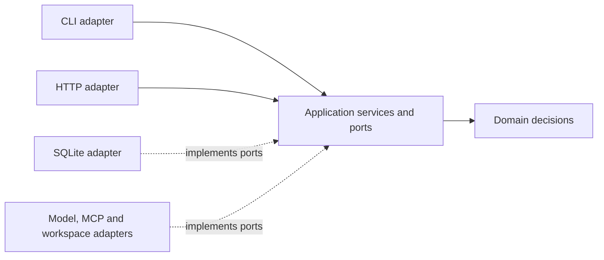

# Architecture

act0r is a two-package Cargo workspace with domain-driven design and ports and adapters. The CLI and HTTP API enter through application services; the same engine owns scheduling and recovery for the native agent policies.

Dependencies point inward. SQLx, Tokio process APIs, HTTP requests and CLI arguments stay in adapters. `crates/act0r-runtime/src/bootstrap.rs` builds the concrete graph.

`act0r-runtime` owns the domain, application services and execution adapters. The root `act0r` package owns the CLI and HTTP transports and re-exports the runtime so existing `act0r::domain`, `act0r::application` and adapter imports work. The runtime has no production dependency on the product package or its HTTP/CLI libraries. Its private crash tests reuse the product HTTP adapter source to exercise reconciliation routes against runtime fault hooks.

Domain, application and SQLite modules remain together because persistence participates in private aggregate transitions. A separate storage crate would first need a deliberate aggregate persistence API. Workspace packages are local components; independent crates.io publication is not configured.

## Consistency boundaries

| Boundary | Owns |
| --- | --- |
| Actor | Stable identity, mailbox admission, task order, memory and lifecycle |
| Run | Versioned execution state, activity attempts, timers, waits and continuation |
| Harness conversation | Ordered user turns, stage links and reviewed project settings |
| Coding task / benchmark | Candidate admission, verification and comparison |

An actor can handle successive tasks. Each task executes in a Run; the actor loop is not an unrecorded in-memory conversation. Application services coordinate these boundaries through storage ports and explicit receipts. See [actors](actor-model.md), [coordination](coordination.md) and [API](api.md).

## One activity boundary

1. A pure policy chooses work from saved state and an event.
2. SQLite commits the activity intent and updated execution state together.
3. The worker admits an attempt under ownership, control and usage checks.
4. A model/tool adapter performs external work.
5. SQLite commits the outcome, history and next continuation atomically.

Recovery reuses committed outcomes. It does not restore a suspended Rust stack or replay successful external calls. Definitions and tool contracts are pinned so incompatible implementations block visibly before more execution.

## Timers and external effects

Timer waits store an absolute UTC deadline and stable identity in SQLite. They survive downtime and become eligible when the worker observes a due deadline. In-process sleeps only pace the worker and transport operations.

An interrupted external call can have an unknown outcome. Read-only MCP calls can repeat under their saved policy; native edits, tests, commands and patch application use their existing effect journals and reconciliation rules. Saving a final response cannot make an arbitrary external write exactly once. See [recovery](recovery.md) and [workspace effects](tools.md).

## Local runtime and storage

SQLite uses WAL, full synchronous commits and foreign keys. Empty databases use `crates/act0r-runtime/schema/baseline.sql`, which creates the current schema directly at version 62 under a single transaction. Version 62 databases retain their data and version. Other versions are rejected without rewriting schema or data; older development databases have no upgrade path.

The baseline is the starting point for future migrations. Add an explicit migration and a preservation test when a future schema change needs one. Tests cover new initialization, reopening current databases, unsupported versions and initialization rollback.

One OS ownership guard permits one worker per canonical database path; that worker can execute independent activities concurrently. The API may run in the same process or separately.

Workspace copies separate coding from the original project. They are not a general OS sandbox for arbitrary tools or project commands. Applying a patch to the original folder is a separate reviewed durable operation.

Distributed leases/fencing and external framework adapters remain future work. The [roadmap](roadmap.md) describes the intended direction.
